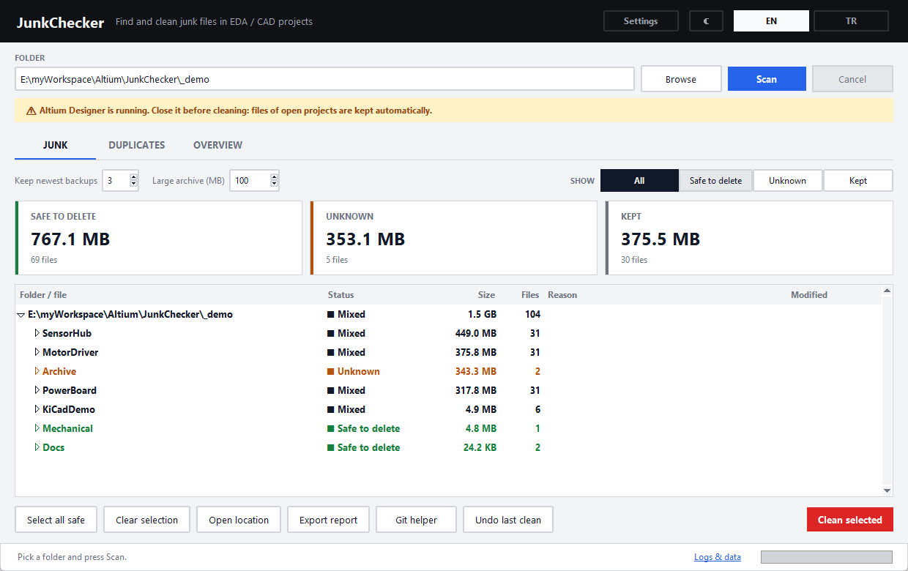
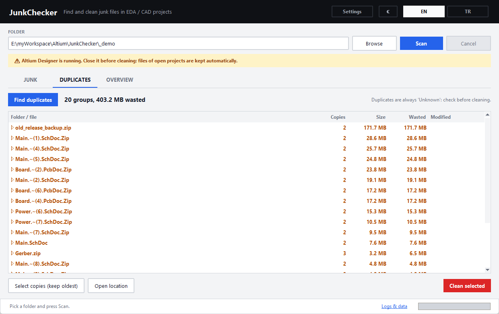
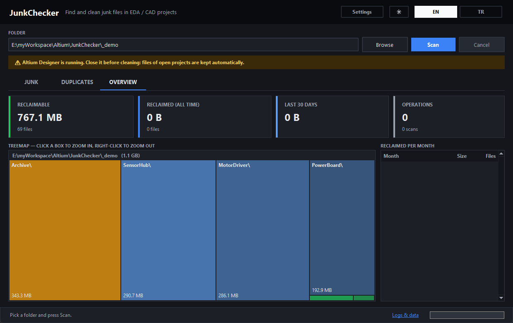

# JunkChecker

Find and clean junk files in EDA / CAD project folders: Altium Designer, CircuitStudio, KiCad and FreeCAD, plus Office temp files and OS junk.
Pure Python 3 + tkinter. No third-party packages are needed to run it.



| Duplicates | Overview (dark theme) |
|---|---|
|  |  |

## Features

- **Rule profiles**: Altium, CircuitStudio, KiCad, FreeCAD, Office and Generic. Rules live in an editable JSON file, and each profile can be switched on or off.
- **Three statuses**:
  - **Safe to delete**: the tool can regenerate it.
  - **Unknown**: large archives, git-tracked files, project outputs and duplicates. Check these yourself.
  - **Kept**: the newest *N* backups, and files of projects that are open in an EDA tool.
- **Exclusions**: exclude a folder or a glob pattern. You can also right-click a folder in the results and choose *Exclude this folder*.
- **Open-project protection**:
  - A warning appears while Altium, KiCad, CircuitStudio or FreeCAD is running.
  - Backups of a project whose files are locked are kept.
- **Clean actions**:
  - Move to the Recycle Bin.
  - Move to an archive folder.
  - Pack into a zip archive. The zip is verified before the originals are removed.
- **Undo last clean**: restores files from the Recycle Bin, the archive folder or the zip.
- **Duplicate finder**: groups files by size, then by a 64 KB hash, then by a full BLAKE2b hash.
- **Overview**: a treemap of the junk with drill-down, and reclaimed-space statistics.
- **Reports**: export results as HTML or CSV.
- **Git helper**:
  - Generates `git rm --cached` commands for junk that was committed by mistake.
  - Suggests `.gitignore` lines.
  - It never runs git write commands itself.
- **Command line and scheduling**, plus an **Explorer context menu**.
- **Interface**: English and Turkish, light and dark theme.
- **Remembers your work**:
  - The last folder.
  - Scan cache per folder.
  - A log of every scan and clean.

## Run

Requires Python 3.9 or newer on Windows.

```bat
JunkChecker.bat                        :: or double-click JunkChecker.pyw
pythonw JunkChecker.pyw "D:\Projects"  :: open and scan a folder
```

### Command line

```bat
python -m junkchecker scan  "D:\Projects" --report report.html
python -m junkchecker clean "D:\Projects" --mode recycle --yes
python -m junkchecker clean "D:\Projects" --mode zip --dest "E:\JunkArchive" --yes
python -m junkchecker dupes "D:\Projects" --min-mb 5
python -m junkchecker restore-last
python -m junkchecker stats
```

`clean` only touches files with the *Safe* status, unless you pass `--include-unknown`. Without `--yes` it asks before doing anything.

### Scheduled clean (Task Scheduler)

```powershell
powershell -ExecutionPolicy Bypass -File tools\schedule_task.ps1 -Folder "D:\Projects" -Mode recycle -Time 18:00
powershell -ExecutionPolicy Bypass -File tools\schedule_task.ps1 -Remove
```

### Explorer context menu

This adds a "Scan with JunkChecker" entry for the current user only. It writes to HKCU and needs no admin rights.

```bat
python -m junkchecker.shell_integration install
python -m junkchecker.shell_integration uninstall
```

### Single-file exe

```bat
pip install pyinstaller
tools\build_exe.bat          :: -> dist\JunkChecker.exe
```

GitHub Actions runs the tests on every push. When you push a `v*` tag, it builds the exe and attaches it to a release.

## Rules

Built-in rules are in [`junkchecker/default_rules.json`](junkchecker/default_rules.json).

To customise them, open **Settings → Edit rules file**. This copies the defaults to `%APPDATA%\JunkChecker\rules.json`. In that file:

- A profile with the same `id` replaces the built-in profile.
- A profile with a new `id` is added.

```json
{"profiles": [{"id": "my-tool", "name": "My tool", "rules": [
  {"category": "my-cache", "status": "safe", "label": {"en": "My tool cache", "tr": "Aracımın önbelleği"},
   "dirs": [".mycache"], "names": ["*.tmpx"], "gitignore": [".mycache/"]}
]}]}
```

| Key | Meaning |
|---|---|
| `status` | `safe` or `unknown` |
| `dirs` / `dir_prefixes` / `dir_suffixes` | a parent folder name equals, starts with or ends with this text |
| `names` / `regex` | file-name glob patterns (case-insensitive) or a regular expression |
| `require_all` | the folder **and** the file name must both match. Without it, either one is enough. |
| `keep` | keep the newest *N* files per group. `{"group": "folder"}` groups by folder. `{"group": "regex", "keep_regex": "(?P<doc>…)(?P<n>\\d+)…"}` groups by document. |
| `gitignore` | patterns that the Git helper suggests |

## Data

Everything is stored in `%APPDATA%\JunkChecker\`. Click **Logs & data** in the status bar to open it.

| File | Content |
|---|---|
| `settings.json` | language, theme, last folder, exclusions, clean action |
| `rules.json` | your rule overrides (optional) |
| `cache\*.json` | the last scan of each folder |
| `history.jsonl` | every scan and clean, used for statistics and *Undo* |
| `logs\junkchecker.log` | readable log, rotated at 2 MB × 5 |

## Tests

```bat
python -m unittest discover -s tests -v
set JUNKCHECKER_TEST_RECYCLE=1 && python -m unittest discover -s tests   :: also test the real Recycle Bin (temp files only)
```

## License

MIT. See [LICENSE](LICENSE). Contributions are welcome; see [CONTRIBUTING.md](CONTRIBUTING.md).

---

## Türkçe

JunkChecker; Altium, CircuitStudio, KiCad ve FreeCAD proje klasörlerindeki çöp dosyaları bulur ve temizler. Office geçici dosyalarını ve işletim sistemi çöplerini de yakalar.

- **Durumlar**:
  - **Kesin silinebilir**: araç bu dosyayı yeniden üretebilir.
  - **Bilinmiyor**: kontrol etmen gerekir.
  - **Saklanacak**: en yeni *N* yedek ve açık projelerin dosyaları.
- **Temizleme yöntemleri**:
  - Geri Dönüşüm Kutusu'na taşı.
  - Arşiv klasörüne taşı.
  - Zip'e paketle.
- **Son temizliği geri al**: dosyalar geri dönüşüm kutusundan, arşiv klasöründen ya da zip'ten geri yüklenir.
- **Diğer özellikler**:
  - Kopya dosya bulucu.
  - Ağaç haritası ve istatistikler.
  - HTML/CSV rapor.
  - Git yardımcısı: komutları sen çalıştırırsın.
  - Hariç tutma listesi.
  - Komut satırı, zamanlanmış görev ve sağ tık menüsü.
  - Açık/koyu tema.
- **Kurallar**: Ayarlar → *Kural dosyasını düzenle* ile özelleştirilir.
- **Veriler**: tüm veriler `%APPDATA%\JunkChecker\` altında tutulur.
